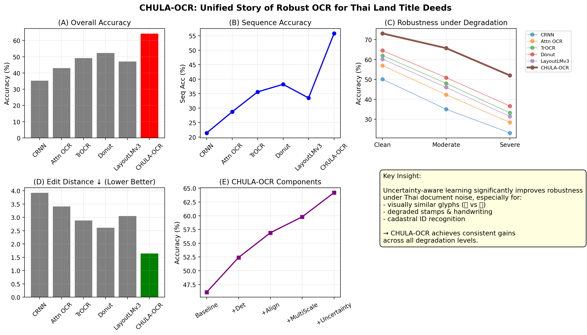
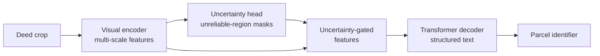
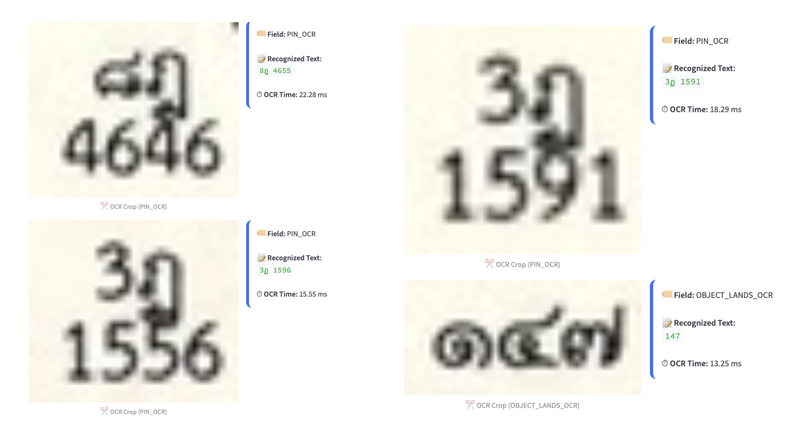
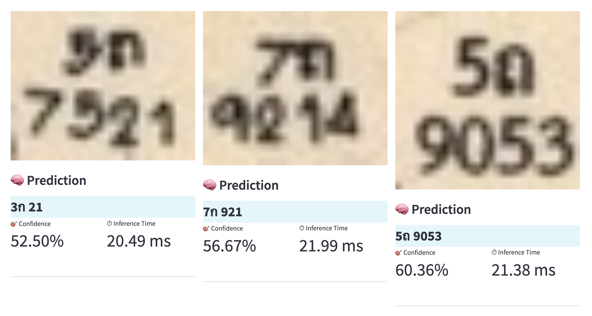
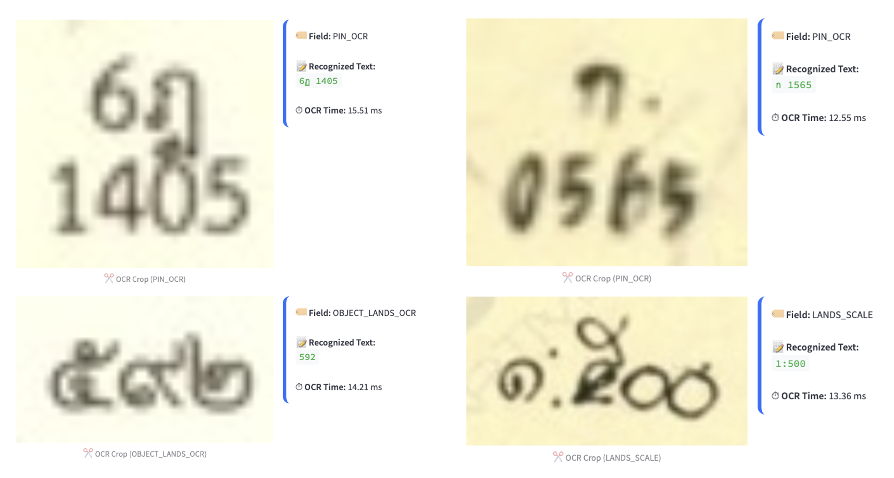
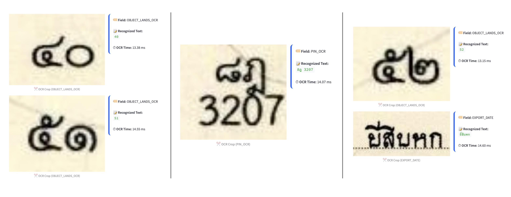

<div align="center">

# CHULA-OCR

### Uncertainty-Aware Robust OCR for Digitizing Land Title Deeds

[](https://doi.org/10.1109/ACCESS.2026.3742999)
[](https://doi.org/10.1109/ACCESS.2026.3742999)

[**Paper**](https://doi.org/10.1109/ACCESS.2026.3742999) ·
[**Project page**](https://kaopanboonyuen.github.io/CHULA-OCR/) ·
[**Dataset**](https://gdc.dol.go.th/dataset/) ·
[**Demo**](https://landsmaps.dol.go.th/) ·
[**Part 1: CHULA**](https://kaopanboonyuen.github.io/CHULA/)

**Teerapong Panboonyuen** · Chulalongkorn University

</div>

---

CHULA-OCR is a robustness-first OCR framework for real-world, heavily degraded legal documents, built around Thai land title deeds. Where conventional OCR breaks on noise, handwriting, stamps, and look-alike characters, CHULA-OCR **estimates its own uncertainty while it reads** and learns which parts of the image to trust.

<div align="center">
  
</div>

## Highlights

- **Uncertainty during perception.** Token-level uncertainty estimation and entropy-guided learning decide which visual evidence to rely on.
- **Gated features.** Unreliable regions (stamps, blur, handwriting overlays) are suppressed before decoding.
- **Structure-aware decoding.** Output keeps the formatting of cadastral identifiers, which matters for legal verification.
- **Built for deployment.** Developed with the needs of Thailand's land administration in mind, targeting national-scale digitization.

| | CHULA-OCR vs. best baseline (Donut) |
|---|---|
| Character accuracy | **64.2** vs. 52.3 (+11.9) |
| Sequence accuracy | **55.8** vs. 38.2 (+17.6) |
| Normalized edit distance ↓ | **1.64** vs. 2.61 |
| Hard cadastral ID exact match | **58.2%** vs. 40.3% (+17.9) |

## The problem

Modern OCR is fragile outside clean benchmarks. Land title deeds combine nearly every failure mode at once:

- Faded ink in historical records
- Handwritten annotations over printed text
- Stamps and seals overlapping text
- Visually similar Thai glyphs, such as ฎ and ฏ
- Heavy scanning degradation in government archives

In land ownership verification, a single wrong character can become an administrative failure. The question CHULA-OCR asks is:

> *Which characters should the model trust when the document itself is unreliable?*

## Method



| Stage | What it does |
|---|---|
| **Visual encoder** | Extracts multi-scale document features and copes with stamps, blur, handwriting, and noise. |
| **Uncertainty estimation head** | Predicts unreliable image regions and outputs confidence-aware feature masks. |
| **Uncertainty-gated features** | Suppresses ambiguous visual tokens and strengthens stable text regions. |
| **Transformer decoder** | Generates structured text sequences, tuned for cadastral formatting consistency. |

### How it differs from other approaches

| Approach | Limitation | CHULA-OCR |
|---|---|---|
| Traditional OCR | Treats all pixels equally and assumes clean input. | Weights evidence by estimated reliability. |
| OCR-free models (Donut-style) | Skip explicit text modeling and lose character-level precision. | Keeps explicit, structure-aware text decoding. |
| Post-OCR correction | Fixes errors after the fact and cannot recover lost visual information. | Handles uncertainty during perception. |

## Results

### Overall performance

| Model | Accuracy | Seq. Acc. | NED ↓ |
|---|:---:|:---:|:---:|
| CRNN | 35.2 | 21.4 | 3.92 |
| TrOCR | 49.1 | 35.6 | 2.88 |
| Donut | 52.3 | 38.2 | 2.61 |
| **CHULA-OCR** | **64.2** | **55.8** | **1.64** |

### Robustness under degradation

| Condition | CHULA-OCR accuracy |
|---|:---:|
| Clean | **73.1%** |
| Moderate noise | **65.7%** |
| Severe degradation | **52.0%** |

CHULA-OCR shows the smallest performance drop among all compared methods.

### Hard cadastral identifier parsing

| Model | Exact match |
|---|:---:|
| TrOCR | 37.5% |
| Donut | 40.3% |
| **CHULA-OCR** | **58.2%** |

## Qualitative insight

Under blur, baselines confuse similar Thai glyph pairs. Handwritten overlays break sequence models, and stamp interference can cause catastrophic decoding errors. CHULA-OCR keeps predictions stable, reduces character-level confusion, and preserves the structure of cadastral identifiers.

<div align="center">
  
  
  
  
</div>

## Impact

CHULA-OCR is meant as national infrastructure for document intelligence, supporting:

- National land registry digitization
- Automated cadastral database construction
- Automated legal document processing
- Less manual verification work
- Scalable, public-sector AI infrastructure

It is **Part 2** of an AI series for Thailand's land record digitization. [**CHULA**](https://kaopanboonyuen.github.io/CHULA/), Part 1, detects and localizes cadastral objects; CHULA-OCR reads the parcel labels attached to them.

## Conclusion

> **Robust OCR for legal documents requires uncertainty-aware perception, not just stronger backbones.**

CHULA-OCR connects academic OCR benchmarks with real government document systems, and offers a deployable path for digitizing Thai land title deeds.

## Citation

If you use this work, please cite:

```bibtex
@article{panboonyuen2026chulaocr,
  title   = {{CHULA-OCR}: Uncertainty-Aware Robust OCR for Digitizing Land Title Deeds},
  author  = {Panboonyuen, Teerapong},
  journal = {IEEE Access},
  year    = {2026},
  doi     = {10.1109/ACCESS.2026.3742999}
}
```

---

<div align="center">

© 2026 CHULA AI Research Lab · Kao Panboonyuen

</div>